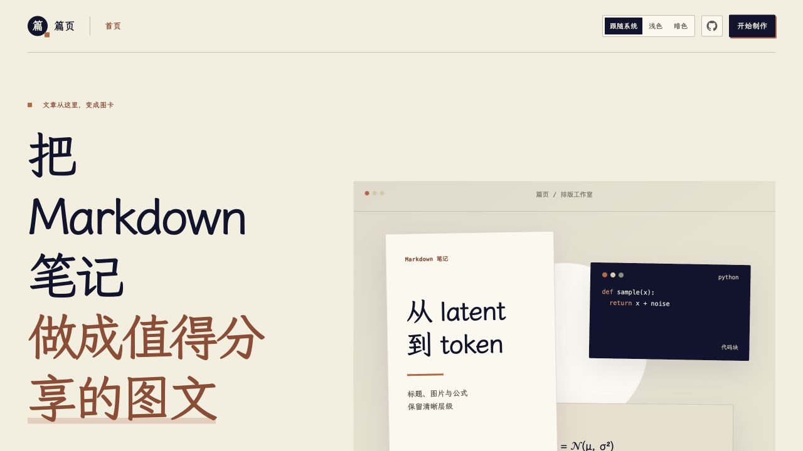

# 篇页 · Markdown 图文工作室

> 把写好的 Markdown 笔记，编排成适合小红书与微信分享的连续图卡。

[打开在线工作台](https://mht5405.github.io/pianye-studio/app/) · [项目主页](https://mht5405.github.io/pianye-studio/) · [完整示例](./examples/篇页示例.md) · [来源与许可](./UPSTREAM.md)



篇页是一款在浏览器中运行的 Markdown 图文排版工具。你可以把学习笔记、读书摘录、课程总结、技术文章或知识整理导入工作台，检查自动分页，调整封面和排版，再下载一组 PNG 图片及 ZIP 压缩包，用于分享或保存。

它适合已经用 Markdown 写作、希望复用原文的人：标题、公式、表格、代码和图片不必逐页重新排版。文章解析、预览和导出在浏览器本地完成；篇页不代替你发布内容，也不替你判断图片是否获得使用授权。

## 快速使用

不需要安装，直接打开 [在线工作台](https://mht5405.github.io/pianye-studio/app/)。首次打开会出现一篇演示文章，可以先用它熟悉操作。

1. **输入内容**：在“Markdown 编辑”区域粘贴或编写文字，也可以选择“导入 Markdown”，或将单篇文件拖入编辑区。支持 `.md`、`.markdown`、`.mdown`、`.mkdn` 和 `.txt`。
2. **处理图片**：文章引用本地图片时，按提示选择文章根目录或图片所在目录；也可通过“管理图片”补齐、绑定或替换。纯文字文章可跳过这一步。
3. **检查并调整**：查看右侧卡片预览和页序，在“排版设置”中按需选择主题、画布、封面、阅读密度和复杂内容的字号。默认是 **3:5 长图文、暗色长文主题、独立封面**。
4. **下载**：点击右上角“下载图片”，选择“标准发布”或“高清原图”；导出前检查通过后，点击“开始下载”，获得包含逐页 PNG 的 ZIP。解压后按页序查看并自行发布。

首次使用建议先用演示文章试一次，再导入自己的文章。桌面端可以拖动编辑区与预览区之间的分隔条；窄屏设备可切换编辑、设置和预览区域。

## 篇页能做什么

| 需求 | 处理方式 |
| --- | --- |
| 复用原文 | 直接输入或导入 Markdown；首个 H1 可作为文章名与封面标题 |
| 调整视觉风格 | 提供“纯净排版”和“暗色长文”两种卡片主题；网页明暗外观独立于卡片主题 |
| 制作封面和署名 | 选择独立封面、融合首页或无封面；替换封面图、调整上下取景，按需设置头像和昵称 |
| 排版复杂内容 | 公式、表格、代码和图片各有独立处理方式；支持调整公式缩放、表格字号、代码字号等 |
| 处理长文 | 根据卡片实际尺寸测量分页；标题尽量与后续内容同行，长表格与长代码可续页 |
| 下载成品 | 使用预览的卡片生成 PNG，逐页打包 ZIP；支持标准发布和高清原图 |

## 用完整示例体验图片绑定

仓库中的 [篇页示例](./examples/篇页示例.md) 包含公式、表格、代码和三张本地 SVG 图片。先下载或克隆整个仓库，保留 `examples/` 下的文章和 `images/`，然后在工作台导入 `篇页示例.md`，出现提示时选择 `examples` 文件夹；确认图片绑定后，可切换主题、画布并尝试导出。文件说明见 [示例说明](./examples/README.md)。

### 本地图片怎样处理

Markdown 文件通常只记录图片的相对路径，例如 ``，并不包含图片本身。浏览器打开文章文件后不会自动获得其所在目录的权限，因此需要你选择文章根目录或图片文件夹；工具会建立目录索引，按引用路径匹配所需图片。

如果图片缺失，打开 **管理图片 → 自动补齐（选择图片所在文件夹）**；如果路径有歧义或同名图片发生冲突，在图片管理器中选择正确图片并手动绑定。绑定不会自动改写 Markdown 原文。远程图片由浏览器请求其来源网站；如果网络不可达或来源网站不允许跨域访问，预览或导出可能失败。

## 排版、分页与导出

“排版设置”分为 **主题、画布、排版、内容**：主题控制卡片样式；画布控制比例、封面、署名和留白；排版控制密度、正文字号与行距等；内容可单独调整图片、表格、公式和代码。网页的浅色 / 暗色切换只影响工作台外观，不改变卡片主题。

文章名优先使用手动填写的名称，其次使用 front matter 的 `title`、首个 H1、导入文件名；首个 H1 用作标题后不会在正文重复显示。分页基于卡片的实际渲染高度，标题会尽量带上后续内容，表格过高时按行续页并重复表头，长代码按行续页。特别宽的表格或很长的公式仍建议先拆分或单独调整字号、缩放。

需要在指定位置换页时，在 Markdown 中单独写一行：

```html
<!-- md2card:break -->
```

普通的 `---` 仍是 Markdown 分隔线。预览时请检查每页的文字、图片和表格：自动分页有助于整理内容，最终发布前仍应由作者检查。

| 画布 | 标准发布 | 高清原图 |
| --- | ---: | ---: |
| 3:4 | 1080 × 1440 | 2160 × 2880 |
| 2:3 | 1080 × 1620 | 2160 × 3240 |
| 3:5 | 1080 × 1800 | 2160 × 3600 |

导出前会检查字体、图片、Markdown 诊断和卡片边界；遇到错误可按提示处理后重新检查。高清长文会占用更多内存且耗时更长，请在下载完成前保持页面打开。

## Markdown 支持与使用边界

支持标题、段落、强调、链接、列表、引用、分隔线、GFM 表格、围栏代码、KaTeX 公式和图片。公式可使用 `$...$`、`$$...$$`、`\(...\)` 或 `\[...\]`；代码支持常见语言高亮，未提供高亮的语言以普通文本显示。文章中的独立图片可使用替代文本或图片标题作为说明。

为保证渲染安全和一致性，普通原始 HTML 会被忽略；上面的手动分页标记是例外。内联图片、复杂 HTML 混排、脚注和 Mermaid 不作为稳定支持功能。建议用 [完整示例](./examples/篇页示例.md) 检查需要的内容能否按预期显示。

## 封面来源与参考资料

在“画布”中使用封面图片时，需要在工作台或 Markdown 中填写图片来源，才能通过导出检查。你也可以在 Markdown 开头的 front matter 中记录封面来源及参考资料，工具会据此生成末尾的“来源与说明”：

```yaml
---
title: "文章标题"
cover_source: "作者，《作品名》，年份，馆藏机构"
cover_source_url: "https://example.org/artwork"
cover_license: "公有领域 / CC BY 4.0 / 已获授权"
references:
  - "作者、资料标题、机构、年份或访问日期"
---

正文从这里开始……
```

来源信息由作者自行填写和核实，工具不会推断出处或授权情况。更多示例见 [封面与来源示例](./examples/cover-and-sources.md)。

## 隐私、保存与浏览器

篇页是静态前端应用：Markdown、排版设置和导入图片在当前浏览器处理，草稿、配置及图片绑定可保存在该浏览器的 IndexedDB；PNG 和 ZIP 也由浏览器生成并下载。GitHub Pages 分发网页和资源，不接收你输入的文章。若文章使用远程图片，浏览器仍会向图片所在网站发出请求。

草稿不是跨设备同步或备份：清除浏览器的站点数据可能同时清除草稿和导入图片，重要内容请保留原始 Markdown 与附件。建议使用最新版桌面 Chrome 或 Edge；移动端可以编辑和预览，但长文或高清导出可能受设备内存影响。其他浏览器的目录选择和导出表现可能不同。

## 本地运行与开发

需要 Node.js 22 或更高版本。克隆仓库后：

```bash
git clone https://github.com/mht5405/pianye-studio.git
cd pianye-studio
npm install
npm run dev
```

打开终端输出的地址，再进入 `/app/`。不要直接双击 `index.html`：`file://` 无法正常启动工作台。开发和构建命令：

```bash
npm test       # 运行单元测试
npm run build  # 类型检查并构建 dist/
npm run preview # 通过本地服务器预览构建结果
```

主要目录：`src/parser` 解析 Markdown，`src/layout` 处理测量与分页，`src/renderer` 渲染卡片，`src/resources` 管理图片，`src/export` 生成 PNG 和 ZIP，`src/app` 负责工作台交互；`examples/` 提供示例，`tests/` 包含测试。项目使用 Vite、Preact、TypeScript、remark、KaTeX、Prism、html-to-image 和 fflate。

仓库提供 [GitHub Pages 工作流](./.github/workflows/deploy.yml)：推送至 `main` 后自动安装依赖、运行测试、构建并部署 `dist/`。首次为自己的仓库配置时，在 **Settings → Pages** 中选择 **GitHub Actions** 作为部署来源。

仓库还附带可复用的 [Markdown 图文制作 Skill](./skill/markdown-to-social-cards/)，供支持该工作流的工具使用。

## 项目来源与许可

篇页是基于 [haodongcui/md2card](https://github.com/haodongcui/md2card) 的非官方衍生项目，与原作者无官方关联；本项目保留上游 MIT 许可证和版权声明。上游版本、主要改动和字体许可见 [UPSTREAM.md](./UPSTREAM.md)。

项目代码采用 [MIT License](./LICENSE)；随项目附带的字体按 [SIL Open Font License](./src/assets/fonts/OFL.txt) 授权，其他依赖遵循各自许可证。
